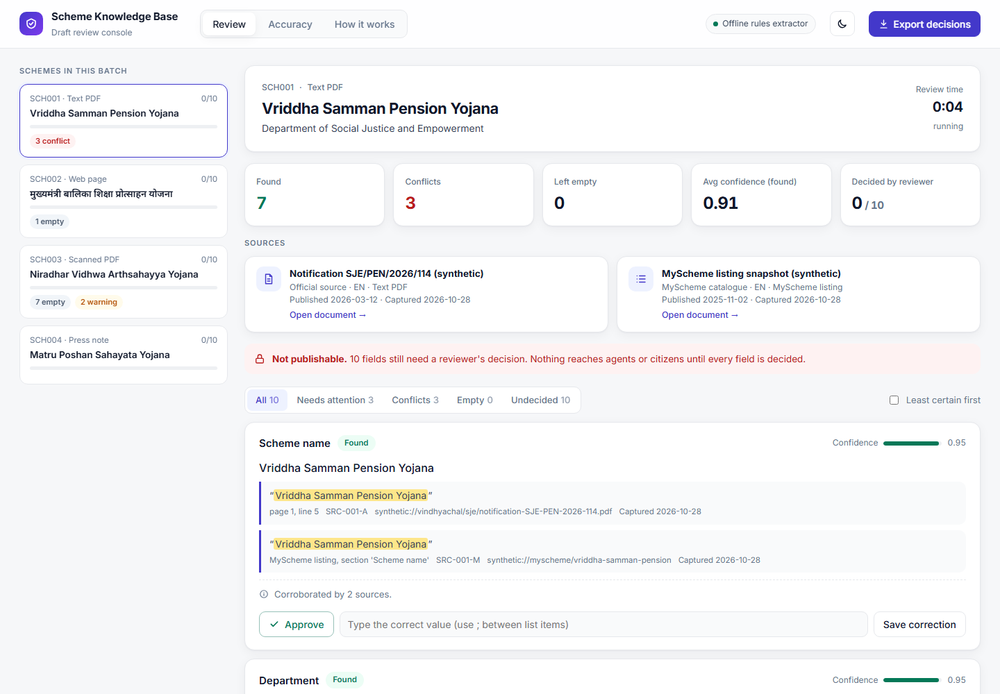
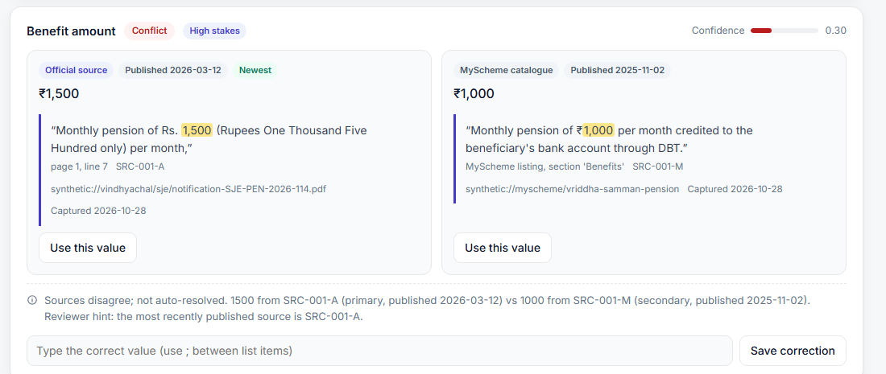
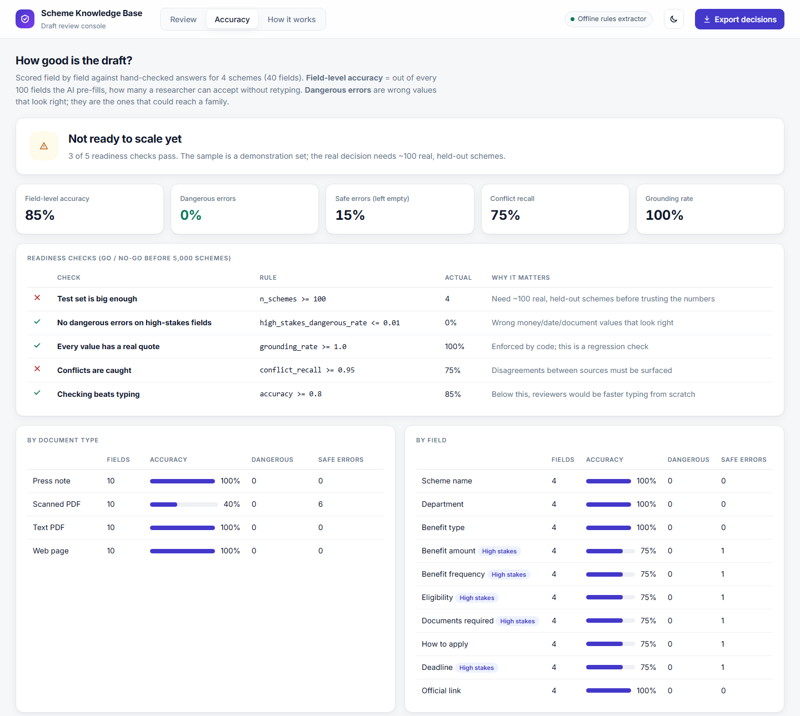

# Scheme Knowledge Base: Field Extraction with Evidence

**Haqdarshak AI/ML Engineer case study · Problem A1**

AI prepares a **first draft** of a government welfare scheme record. Every value shows the **exact quote, page and source** it came from. When sources disagree, **both values are kept** and flagged as a conflict. A researcher approves every field in a review console before anything can be published.



## Quick start

```bash
cd scheme-kb-extractor
pip install -r requirements.txt
python -m skb all        # extract → evaluate → build the review console (offline, no API key needed)
python -m pytest -q      # 15 edge-case tests
```

Then open `scheme-kb-extractor/out/review.html` in a browser. It has three tabs: **Review**, **Accuracy** and **How it works**.

Optional AI mode: set a free `GROQ_API_KEY` from console.groq.com and run `python -m skb all --mode llm`. This uses GPT-OSS-120B for text, plus a Llama 4 Scout vision model that reads scanned pages.

## The two rules, enforced in code

1. **A person always checks before anything goes live.** The draft stays locked as *Not publishable* until every field has a reviewer's decision.
2. **Every fact points back to its source.** A value survives only if its quote is found word for word in the document. Otherwise the field stays empty, with the reason.

## Conflicts are never resolved silently

The official notification revised the pension to ₹1,500, but MyScheme still shows ₹1,000. Both values are kept, each with its own evidence, and the newer source is marked:



## Test documents and the edge case each one covers

| Scheme | Source | Edge case |
|---|---|---|
| SCH001 | English PDF + MyScheme | Amount and deadline conflict; a missing document; an "earlier ₹1,000" trap and an income-ceiling trap |
| SCH002 | **Hindi** web page | Devanagari digits (₹ १०,०००), no fixed deadline, no official link (left empty, not invented) |
| SCH003 | **Scanned Marathi** PDF + MyScheme | Image-only document; stale MyScheme amount; out-of-date source warning |
| SCH004 | English press note + MyScheme | Amount given only as "as per norms"; relative deadline; name taken from the headline |

All documents are synthetic: the state is fictional and all links are placeholders.

## Measuring accuracy



| Offline extractor | Result |
|---|---|
| Field-level accuracy | 85% |
| Dangerous errors (wrong value that looks right) | **0%** |
| Conflict recall | 75% |
| Grounding rate (values with a real quote) | 100% |
| Ready to scale to 5,000 schemes? | **Not yet**: the test set is too small, and the conflict inside the scan was missed |

A readiness gate decides when extraction is good enough to scale. It requires all of:
- at least 100 held-out real schemes
- at most 1% dangerous errors on money, date and document fields
- 100% grounding
- at least 95% conflict recall
- at least 80% accuracy for each document type

## Full documentation

See **[scheme-kb-extractor/README.md](scheme-kb-extractor/README.md)** for:
- the architecture
- the field format, with a real example
- the accuracy method and go/no-go plan
- the model and cost per scheme
- decisions and the options I rejected
- assumptions
- known limitations
- what was left out on purpose
- how AI tools were used

## Repository layout

```
scheme-kb-extractor/
  skb/        the pipeline: load → extract → verify → reconcile → evaluate → review console
  data/       synthetic source documents, MyScheme snapshots, manifest, hand-checked answers
  out/        generated records, evaluation reports, review.html
  tests/      15 edge-case tests
  docs/       screenshots
```
